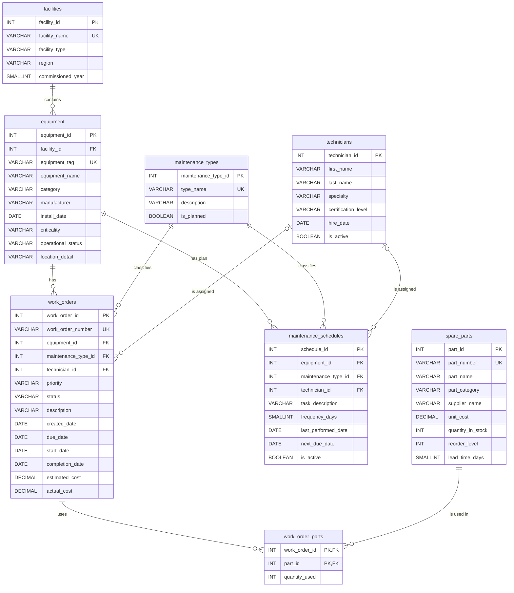

# Entity Relationship Diagram

This diagram shows the 8 tables created by [`database/02_create_tables.sql`](../database/02_create_tables.sql), with their columns, primary keys (PK), foreign keys (FK) and unique keys (UK). It was generated from that script, so the table and column names match it exactly. Column lengths (for example `VARCHAR(100)`) and CHECK constraints are only listed in the SQL script.

GitHub renders the Mermaid diagram below automatically.

## How to read the relationships

| Relationship | Meaning |
|---|---|
| `facilities` 1 : N `equipment` | A facility contains many equipment assets; each asset belongs to exactly one facility. |
| `equipment` 1 : N `work_orders` | An asset can have many work orders; each work order is for one asset. |
| `equipment` 1 : N `maintenance_schedules` | An asset can have several recurring maintenance plans. |
| `maintenance_types` 1 : N `work_orders` | Every work order has exactly one maintenance type. |
| `maintenance_types` 1 : N `maintenance_schedules` | Every schedule has exactly one maintenance type. |
| `technicians` 0..1 : N `work_orders` | A technician can have many work orders. A work order may be unassigned (`technician_id` is NULL). |
| `technicians` 0..1 : N `maintenance_schedules` | A technician can be responsible for many schedules; the assignment is optional. |
| `work_orders` N : M `spare_parts` | Through `work_order_parts`: a work order can use many parts, and a part can be used on many work orders. |

Symbols: `||` exactly one, `|o` zero or one, `o{` zero or many.
